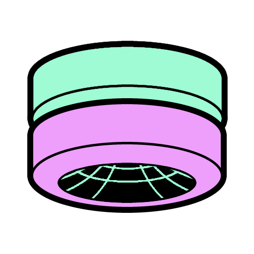

  

# AudioHole

Put your audio wherever you want.

AudioHole is a Windows application for connecting existing capture and playback
endpoints through saved routing profiles. A **hole** connects a source to a
destination; duplex holes add an independent return path. **Plug Board** organizes
application output assignments into reusable routing boards.

[Build instructions](BUILDING.md) · [Documentation](docs/README.md) ·
[Contributing](CONTRIBUTING.md) · [GPLv3](LICENSE)

## Get started

Download a successful Windows build from [GitHub Actions](https://github.com/RLCypher/audiohole/actions).
Use the portable ZIP, or the optional installer for a conventional installation.
Extract the portable package before running `AudioHole.exe`.

The guided tutorial uses fictional devices and applications, with Norm explaining
each step. Normal operation uses your real Windows endpoints. Keep your playback
volume comfortable while testing a new route.

AudioHole is under active development. CI verifies software contracts and GUI
flows; it does not establish compatibility or measured latency for every device.

## What is included

- Saved profiles with simplex and duplex routing, independent endpoint preferences
  and optional advanced format, latency and buffering controls.
- Device discovery, capability scanning and readable JSON configuration.
- Plug Board application assignments, board libraries and profile associations.
- Temporary source activity checks, destination test beeps, diagnostics and tray controls.
- Light, Dark and Follow System themes, with optional Norm and Horu commentary.

## Find your way around

| Folder | Contents |
| --- | --- |
| [src](src) | Application, interface, controller and scanner code |
| [engine](engine) | Audio engine module |
| [modules](modules) | Plug Board module |
| [personalities](personalities) | Editable personality packages |
| [docs](docs/README.md) | User, design and validation documentation |
| [tests](tests) | Automated checks |
| [scripts](scripts) and [installer](installer) | Build, packaging and optional installer tools |

Developers should start with [BUILDING.md](BUILDING.md), [CONTRIBUTING.md](CONTRIBUTING.md)
and [AGENTS.md](AGENTS.md). Detailed specifications live under
[docs/specifications](docs/specifications/README.md).

## License and contributions

First-party code is licensed under [GPLv3](LICENSE), **GPL-3.0-only**. Donations and
commercial distribution are compatible with the license. Contributions use DCO
sign-off; there is no broad relicensing CLA.

Artwork and branding terms remain separately under review. See the
[licensing details](docs/legal/LICENSING.md) for scope and third-party notices,
[corresponding source](docs/development/SOURCE.md), and
[AI disclosure](docs/specifications/AI_DISCLOSURE.md).
