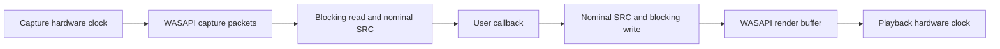
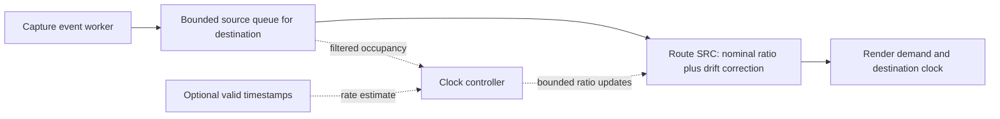

# Duplex operation and independent clocks

Pinned revision and evidence labels: [README](README.md). Source keys: [G1–G3, W2, W4, B1–B2, R1–R4](SOURCE_REFERENCES.md).

## The Windows path, not the generic asynchronous path

**Verified.** WASAPI's registration sets `onDeviceRead=ma_device_read__wasapi`, `onDeviceWrite=ma_device_write__wasapi`, `onDeviceDataLoop=NULL`. The worker enters `ma_device_audio_thread__default_read_write`. For duplex it:

1. Chooses a capture batch of `min(capture.internalPeriodSizeInFrames, playback.internalPeriodSizeInFrames)`; these are raw frame counts even when endpoint rates differ.
2. Performs a blocking capture read, split to fit 4096-byte scratch.
3. Converts native capture frames to common client-rate capture format.
4. Calls the user once per generated chunk with input and output frame counts equal at the common client rate (possibly through the fixed-size callback adapter).
5. Converts client output to native playback format and performs blocking writes.
6. Repeats until stopped or an error exits the loop.

Render backpressure limits progress once queued output fills, but a capture read can also block the same worker. It is more precise to call this sequential blocking/backpressure coordination than an unconditional playback-triggered callback. No asynchronous queue occupancy controller appears in this path. [G1, W4]

The separate `ma_device__handle_duplex_callback_capture/playback` helpers service **asynchronous** backends. They write capture into `ma_pcm_rb`, discard new frames if the ring fills, read available input when playback calls, and supply silence on starvation. A `ma_duplex_rb` can be five capture periods in capacity, primed by advancing write position two capture periods. Those paths are not selected by the stock WASAPI registration; do not charge their priming latency to Windows duplex. [G2, B2]

## What kinds of devices can be paired?

| Scenario | Verified library mechanism | What remains unproved or missing |
| --- | --- | --- |
| Same physical device, capture/render endpoints | Independent endpoint initialization and IDs; common client rate | No clock-domain validation. Physical association alone does not establish sample synchronization. |
| Separate devices, identical nominal rate | Same duplex interface accepts separate IDs | Actual oscillator drift is uncorrected continuously. |
| Different nominal rates | Per-endpoint converters and/or Windows automatic nominal SRC | Correct average nominal rate is not actual hardware-rate tracking. |
| Independent clocks at matching nominal rates | No common-clock requirement or rate measurement | Equal-rate converter bypass can mean no SRC exists at all; a route controller must still be possible. |

An AudioHole duplex hole is two directional paths. It cannot be equated with one library duplex object: a library object only has one input and one output. Two objects can represent forward and reverse paths, but tying each object's capture/render worker can complicate fault isolation and source sharing. Separate capture and render objects plus per-destination queues are another strategy. Neither is adopted here. [project baseline](PROJECT_BASELINE.md)

## Drift: equation, units and worked example

**Inferred from conservation of frames, not measured.** Let `q(t)` be queued source frames, actual source rate `Fc` and actual destination frame rate `Fr`. Let `r` be source frames consumed per output frame (input/output ratio). Ignoring packet scheduling:

`dq/dt = Fc - r*Fr` (source frames/s).

A nominal converter uses `r0 = Fc_nom/Fr_nom`. Stable occupancy instead requires `r* = Fc_actual/Fr_actual`. Equal advertised rates set r0=1 but do not establish r*=1.

At 48 kHz with source +100 ppm relative to destination, excess is `48000*100e-6 = 4.8 frames/s`. A queue with 240 frames of headroom reaches its high limit in approximately `240/4.8=50 s`; 96 frames reaches it in 20 s. With negative mismatch it depletes. These are idealized estimates; packet jitter and initial hardware buffering shift observed failure time. Increasing capacity delays failure while increasing potential residence time; it does not fix persistent drift.

## Actual mismatch recovery

**Verified.** `ma_device_read__wasapi` tests `DATA_DISCONTINUITY`. In duplex it estimates packet-discard iteration count as:

`periodCount = floor(actualCaptureBufferFrames/captureProcessingPeriodFrames)`

`iterations = ceil(periodCount/2)`

For each iteration it releases the currently mapped packet and fetches the next one, leaving the final fetched packet for processing, or clears mapping state if empty/error. The number discarded depends on packet sizes and reported configuration; this is not a measured half-buffer occupancy regulator. Ordinary capture logs the discontinuity (under debug conditions) but does not perform this duplex discard recovery. Silence flags zero samples. Read/write waits and failures provide backpressure/error handling, not a continuous rate adjustment. [W4]

No timestamp estimator, occupancy target, ppm correction, PI loop, or call that continuously changes either device converter's rate was found by tracing initialization → worker → duplex branch → native read/write. Device converters set `allowDynamicSampleRate=MA_FALSE`. Fixed nominal conversion may create varying integer counts as part of interpolation but does not observe drift. No deliberate “duplicate one sample per clock mismatch” policy was found in this path. Dropping capture packets after a glitch is explicit; application callback can also choose to copy, synthesize or silence output. [G1, G3, R4]

**Inferred:** if capture outruns render, unread capture accumulates until loss/recovery; if render outruns capture, capture waiting can starve playback. Drivers and Windows buffering determine exactly which flags, gaps and errors occur. The source supports the absence of a continuous solution, not a claim that every hardware pairing always glitches after one fixed interval.

## What AudioHole must supply

**Experimental architecture, compatible with destination pacing:** one capture producer drains packets promptly into a bounded preallocated source queue; each independent destination consumes enough source frames to fill its render demand. For mirrored outputs, use distinct per-destination queues/read positions and compensation, not a multi-reader misuse of an SPSC ring. A capture stream may be shared if ownership and channel policy are explicit.

Required functionality:

- Queue accounting in one known frame domain, startup target and jitter margin; silence/overflow policies with explicit lost-frame counters.
- Actual drift estimate from filtered occupancy, optional reliable device-position/QPC rate estimates, distinction between drift, burst jitter, invalid timestamps, stalls and discontinuities.
- Rate actuator with adequate ppm resolution, phase continuity, bounded update cost and tested spectral artifacts. The generic miniaudio ratio helper is unsuitable at this revision; see [resampling](RESAMPLING.md).
- Clamp and slew limits, anti-windup, re-prime/reset after discontinuity, no unbounded catch-up loop.
- A control/supervisor thread for stop/recovery, no blocking enumeration or lifecycle operations in application data callbacks.
- Per-direction fault isolation, durable endpoint binding and cancellation of pending recovery after explicit Stop.

An illustrative controller sampled every `Δt` seconds can use filtered normalized error `e=(q-qTarget)/capacity`, integrator `I=clamp(I+Ki*e*Δt)`, correction `u=clamp(Kp*e+I, ±uMax)`, and `r=r0*(1+u)` with a slew bound. Positive occupancy error must **increase** input/output ratio. Gains have units consistent with this normalized error; no numeric gains, target occupancy or ppm limit are established here. Timestamp-based feed-forward can estimate r* and let the occupancy controller handle residual error. This is a proposed experiment, not an upstream algorithm or stability proof.

**Disposition:** Adapt the component mechanisms; reject treating stock duplex and nominal SRC as complete arbitrary-clock routing. Evaluate separate I/O workers in all backend strategies under the same queue/controller policy so comparison does not confound backend with synchronization design.

## Current baseline: compensation location is still open

The remote publication baseline accepts destination pacing/FIFOs/adaptive synchronization but leaves the actuator open. The diagram and PI equations above are **one application-managed experiment**, not an argument to prefer custom production DSP. Compare established SRC candidates (including SpeexDSP as a separate dependency) with Windows-managed shared-render adjustment. In the latter case queue error still needs an estimator/controller, but SetSampleRate is issued on a control thread and uses an absolute frames/s target; derive its sign/units against the actual stream/engine path instead of blindly substituting the input/output ratio. Strict preservation is an internal experiment: report inability to continue and permit explicit restart/rebuffer rather than silent drops/resampling. See current D-034/O-005 and E11.
