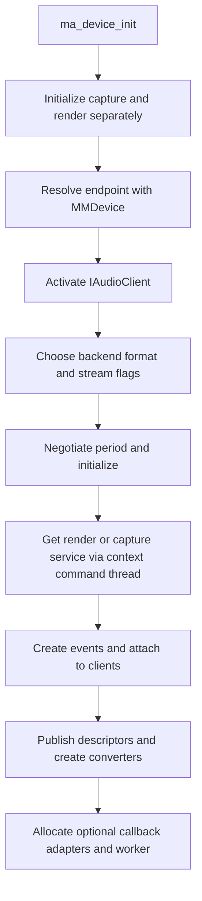

# Windows WASAPI backend

Scope: desktop Windows path at `9634bedb5b5a2ca38c1ee7108a9358a4e233f14d` (0.11.25). **Verified** below means inspected source, not executed Windows behavior. References [W1–W4, G1–G3, D1–D3, T1](SOURCE_REFERENCES.md).

## Structures, discovery and initialization flow

`ma_context` owns backend callbacks, dynamically loaded OS entry points, allocation/logging callbacks, and a WASAPI command thread. `ma_device` owns endpoint converters and descriptors, the processing worker, lifecycle events, capture/render clients, mapped-packet state and notification client. `ma_device_config` describes client-facing format/rate, IDs, share modes, requested periods, callbacks and WASAPI flags. `ma_device_descriptor` is rewritten with negotiated backend settings. `ma_device_init_internal_data__wasapi` carries one endpoint's input request and actual result; that function rejects duplex type because capture and render are initialized separately. [W1, W2, G3]

Desktop enumeration creates `IMMDeviceEnumerator`, enumerates `eRender` and `eCapture` with `DEVICE_STATE_ACTIVE`, obtains endpoint IDs using `IMMDevice::GetId` and friendly names from property stores. Default resolution uses `eConsole`. Explicit IDs use `GetDevice`; null IDs resolve the default. This is endpoint identity on one Windows installation, not hardware fingerprinting. Detailed capability retrieval is separate from simple enumeration. [D1, D2]

A context command queue/mutex/semaphore and completion event mediate service acquisition (`GetService` for render/capture clients). This is initialization/control work, not a command queue crossed by every PCM buffer. Do not attribute one context-thread handoff to every audio callback. OS/COM dependencies include `ole32`, MMDevice, `IAudioClient`/2/3, property store, `avrt`, kernel events and Win32 threads; miniaudio defines its own interface wrappers and generally resolves APIs dynamically. [W1, T1]

## Actual format selection

Shared mode calls `GetMixFormat`. Channel count/representation come from that format, not arbitrary caller format requests; the channel mask becomes the internal channel map. Different client-facing formats are handled by miniaudio's converters.

Unless `noAutoConvertSRC` is set, a nonzero requested rate in nonexclusive mode enables `AUTOCONVERTPCM`; `SRC_DEFAULT_QUALITY` is also set unless disabled. The backend rewrites the stream rate to the requested rate and lets Windows do nominal SRC. Therefore internal stream format matching the client does not prove that the Windows engine performs no conversion. Setting `noAutoConvertSRC` keeps the stream at the mix rate and shifts any required rate conversion to the library. An intentional native-rate stream plus a single route-level converter may simplify accounting; that is an experimental integration choice. [W2, G3]

Exclusive desktop mode retrieves `PKEY_AudioEngine_DeviceFormat`, asks `IsFormatSupported(EXCLUSIVE)` for it, and uses that format. It does **not** search all desired sample rates, valid bit depths, layouts, or formats on initialization. A separate information function can search for one exclusive candidate if the property format fails, but that is not proof the initializer can select that candidate. UWP exclusive support is explicitly disabled in this source; desktop findings cannot be extrapolated to UWP. [W2, D2]

Some comments claim exclusive-to-shared fallback. Actual failure branches return `MA_SHARE_MODE_NOT_SUPPORTED`, `MA_BUSY`, `MA_ACCESS_DENIED` or mapped error; failed exclusive initialization explicitly does not retry shared. An application can choose a new configuration, but must preserve the user's mode and diagnostics. The executable path takes precedence over these stale comments. [W2]

## Period and buffer mathematics

Let requested period `P` be frames, sample rate `F` frames/s, period count `K` dimensionless.

- Zero request: use 10 ms (low latency profile) or 100 ms (conservative); default `K=3`.
- Milliseconds to frames: `P = floor(ms*F/1000)` using 32-bit unsigned multiplication.
- Period duration: `u = floor(P*10^6/F)` microseconds using a 64-bit product.
- Legacy requested buffer duration: `H = u*K*10` in 100 ns units.

These are requested values, not measured latency. Normal ranges fit; user-supplied huge `ms*F` can wrap and must be bounded by AudioHole. [W2, B3]

### Shared `IAudioClient3`

Unless compiled with `MA_WASAPI_NO_LOW_LATENCY_SHARED_MODE`, miniaudio tries Client3 when Windows automatic SRC is absent **or** the requested stream rate equals the original mix rate. It queries `GetSharedModeEnginePeriod` for default, fundamental `f`, minimum `m`, maximum `M` periods, in frames. The code computes:

`A = clamp(floor(P/f)*f, m, M)`

Then it attempts `InitializeSharedAudioStream` only if `A >= P`, stripping the automatic-SRC flags. This guard has a surprising consequence: an in-range nonmultiple can fall back to legacy initialization because the rounding went down. Hypothetical valid bounds `f=48,m=48,M=480,P=100` give `A=96`, and 96<100 skips Client3. `P=96` attempts 96. If `P<m`, clamping up can allow the attempt. If `P>M`, legacy fallback preserves the desire for a larger buffer. This is source-derived control flow, not an observed driver result. [W2]

[Microsoft's Client3 contract](https://learn.microsoft.com/en-us/windows/win32/api/audioclient/nf-audioclient-iaudioclient3-initializesharedaudiostream) requires a period that is a fundamental multiple within the reported range; the API computes the buffer size. Selecting such a period directly gives AudioHole more predictable control. Miniaudio's unexpected fallback for an off-grid request should be measured, not assumed to add a fixed delay.

Successful Client3 records actual period `A`; legacy shared mode calls `IAudioClient::Initialize` with buffer duration `H`, periodicity zero, then reports `GetBufferSize()/K` as an internal processing period. This quotient is a library chunking convention, not necessarily the Windows engine's wake-up period. Actual buffer capacity is also retrieved separately. Always inspect both actual capacity and chunk size. [W2]

### Exclusive mode

Calls `Initialize(EXCLUSIVE, EVENTCALLBACK, H, H, format, NULL)`; equal duration/periodicity is intentional for event mode. On `INVALID_DEVICE_PERIOD`, doubles duration until the code's 500 ms comparison stops retries (the last attempted value can exceed 500 ms because the check precedes doubling). On `BUFFER_SIZE_NOT_ALIGNED`, gets driver-required frames `B`, computes `round(10^7*B/F)`, releases/reactivates the audio client and retries. Failure is returned. Success obtains actual buffer frames and derives a processing subperiod by division by K; writes nevertheless map the **whole exclusive buffer**. [W2, W4]

## Event-driven I/O and actual data path

Backend registration supplies blocking reads and writes with no custom WASAPI data loop. `ma_worker_thread` therefore runs `ma_device_audio_thread__default_read_write`. This is event-driven waiting *inside a blocking wrapper*, not the asynchronous callback backend path. [G1, W4]

Capture maintains mapped pointer, capacity and remaining length. It copies from the mapped WASAPI packet into stack scratch, releases the full packet when consumed, obtains another packet with `GetBuffer`, and waits on the capture event when empty or on temporary buffer error. It synthesizes silence for `SILENT`. GetBuffer passes NULL for both device and QPC positions. In duplex only, `DATA_DISCONTINUITY` triggers discarding approximately half a buffer's worth of packets. See [clock analysis](DUPLEX_AND_CLOCKS.md). [W4]

Render copies stack scratch into a mapped WASAPI buffer. Shared writes request the negotiated processing period; exclusive writes request actual buffer capacity. Full mappings are released; shared mode waits after `BUFFER_TOO_LARGE`/temporary `BUFFER_ERROR`, exclusive mode waits after full-buffer release. The wrapper can retain a partly consumed capture packet or partly filled output buffer across calls. [W4]

Both events are created with `CreateEventA(..., FALSE, ...)`, hence **auto-reset**, despite comments claiming manual reset. Capture begins unsignaled; playback begins signaled. General read/write wait timeout defaults to 5000 ms; loopback uses a 10 ms wait and continues waiting. Five seconds is a failure bound, not intended callback cadence. Explicit stop wakes events. [W4, T1]

## Windows facilities exposed and missing

| Facility | Examined miniaudio path | Consequence for AudioHole |
| --- | --- | --- |
| Shared/exclusive | Endpoint share-mode fields; restricted native format choice | Fine candidate probing needs native APIs or extension. |
| Client3 small periods | Already attempted, eligibility/rounding conditions above | Direct access does not uniquely enable low-latency shared mode. |
| MMCSS | Usage opt-in, Games/Pro Audio; no extra MMCSS priority setter | Configure and observe success; [scheduling report](SCHEDULING.md). |
| Raw/engine format options | Initialization tries offload unless disabled; no general raw/session/category configuration in config | Native extension can expose needed options; do not enable speculative features by default. |
| Device clock / capture timestamp | Packet timestamps not requested; no IAudioClock feedback in path | Timestamp-based clock estimator needs additional instrumentation. |
| Discontinuity | Capture flag handling and packet discard | Does not provide structured route-level lost-frame estimates. |
| Default-device migration | Limited built-in rerouting | Application policy may prohibit silent substitution; use explicit bindings. |
| HRESULTs | Some logs include raw code; errors map to `ma_result` | Structured diagnostics need native capture or extension; logs alone are insufficient evidence. |
| Zero-copy endpoint access | Callback receives library buffers in blocking path | Direct native fill/drain may remove copies; benefit unmeasured. |

**Assessment:** Adapt existing negotiation and lifecycle techniques, investigate equivalent native/miniaudio configurations, reject source-independent latency claims. Native access offers concrete control/timing/diagnostic benefits; its speed advantage is unproven.

## Windows-managed shared-render adjustment candidate

**Verified source:** a full-header search finds `MA_AUDCLNT_STREAMFLAGS_RATEADJUST` defined at line 21815, but no use in stream initialization and no `IAudioClockAdjustment`/`SetSampleRate` service path. A constant alone is not a feature. This differs from Windows `AUTOCONVERTPCM` nominal format conversion.

[Microsoft stream flags](https://learn.microsoft.com/en-us/windows/win32/coreaudio/audclnt-streamflags-xxx-constants) describes RATEADJUST initialization followed by GetService for IAudioClockAdjustment, valid for shared rendering. [SetSampleRate](https://learn.microsoft.com/en-us/windows/win32/api/audioclient/nf-audioclient-iaudioclockadjustment-setsamplerate) takes frames/s and must not run on the real-time thread. A native backend can investigate that actuator, while stock miniaudio needs an extension. Current Client3 documentation lists only EVENTCALLBACK among supported stream flags; do not assume RATEADJUST works through InitializeSharedAudioStream. Legacy shared event initialization and low-period Client3 must be compared with actual HRESULTs and unavoidable period differences recorded.

This is a current AudioHole D-034/O-005 candidate. It shifts compensation into Windows but does not prove unchanged samples, remove controller/occupancy responsibilities, or apply to capture/exclusive mode. **Investigate Further**, not an adopted backend advantage or measured latency improvement.
