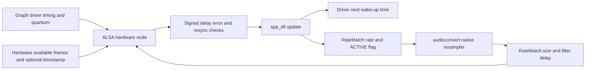
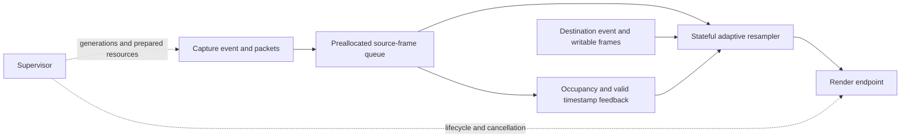

# Architecture and project baseline

Publication note: [CURRENT_BASELINE.md](CURRENT_BASELINE.md) records the newer remote `work` revision and supersedes historical AudioHole status/policy statements below. PipeWire source findings retain their pinned upstream baseline.

## AudioHole before this investigation

**Verified from AudioHole commit `a2aaf7a8ca2b14c3ca37b59cf6d8bc255124a984`:** the tracked tree contains specification documents only. No CMake project, engine code, or completed hardware test record is present. Read the repository-relative baseline documents below as requirements and proposed design, not implementation evidence.

| Baseline | Relevant requirement or open decision |
|---|---|
| `README.md`, `SPEC.md` §§10–13 | Windows 10/11 x64, C++, low-latency endpoint routing, no custom virtual driver; ≤10 ms attributable latency, 5 ms stretch, measured separately from external latency. |
| `ARCHITECTURE.md` §§4–6, 9–11 | Controller/supervisor/engine separation; backend clock diagnostics; independent streams, bounded preallocated buffers, event-driven audio, MMCSS evaluation; monitor occupancy/timing, distinguish jitter from drift/stalls. |
| `ARCHITECTURE.md` §§6.3–6.5; D-007, D-008, D-053 | Duplex is one logical hole with two independently configured directions; 1–4 normal and 5–8 extended holes; mirrors use separate holes and independent destination compensation, with capture reuse where safe. |
| `DECISIONS.md` D-030, D-034, D-035 | Backend, resampling/conversion, and buffer recommendations are **Open**. Native WASAPI, miniaudio, and hybrid require prototype evidence. |
| `DEPENDENCIES.md` §§2.2, 4.4, 5 | Prior miniaudio experience is advisory; matching format is not clock synchronization; native WASAPI is a first-class candidate, not automatically faster. |
| `DEVICE_PROBING.md`; D-006, D-013, D-014, D-036 | Portable logical identity differs from transient endpoint binding; ambiguous matches need explicit resolution; Easy Scan is nonintrusive, Advanced Scan needs consent; matching algorithm remains open. |
| `PROFILES.md`; D-019–D-023 | Supervisor-owned canonical state, automatic recovery with explicit Stop cancellation, transactional switching, staged routing changes; healthy paths should remain operational where possible. |
| `ROADMAP.md` milestones 1.1–1.4 and 9.1 | Backend, duplex, drift/buffering, and identity validation precede production commitment; measured attributable latency comes later. |

The original baseline does not prescribe a named DLL, target queue depth, ASRC implementation, or destination-paced master policy. Current `work` now accepts destination pacing and bounded destination FIFOs; the final algorithms remain open as detailed in [CURRENT_BASELINE.md](CURRENT_BASELINE.md). Research recommendations cannot silently close those decisions. Clock identity is a runtime timing property; portable device identity remains an independent configuration concern.

## Examined PipeWire path

**Verified, S02–S05:** a hardware SPA node can be a graph driver or follower. `spa_io_position.clock` carries the selected driver's graph timing, while each node's `spa_io_clock` identifies its own clock. `spa_alsa_reassign_follower()` compares IDs; `setup_matching()` compares clock names. `audioadapter.c:link_io()` installs the same `spa_io_rate_match` on hardware and converter ports when conversion is active. This establishes actual wiring, beyond merely finding a DLL header.

ALSA driver wake-up work first performs clock/delay synchronization for itself and followers, reads its own capture data if applicable, then triggers graph processing. Other follower capture reads wait until their converter can determine required input. Playback is written as the graph completes. The arrangement matters: the observation is taken at a defined processing phase, and required capture input is not assumed to equal the graph quantum. [S02](SOURCE_REFERENCES.md#s02), lines 3541–3578.

`impl-node.c:insert_driver()` orders driver candidates by `priority.driver`; context graph recalculation groups linked nodes, collects constraints, and activates followers before the driver. The presence of policy, priorities, and potentially multiple driver groups means there is no universal "PipeWire always uses the output clock" rule. [S09](SOURCE_REFERENCES.md#s09), [S10](SOURCE_REFERENCES.md#s10)

## Proposed small AudioHole equivalent

**Experimental:** for one direction, let the destination render event pace output production. A capture event worker drains packets into a bounded source-domain queue. At a fixed point before rendering, the destination worker measures the queue, updates one controller, and requests exactly the available destination frames from a stateful ASRC. Capture never blocks on render work. The supervisor owns endpoint lifecycle and recovery outside audio callbacks.

For source F_s and destination F_d, define the actuator explicitly as **source frames consumed per destination frame**. A queue above target must increase this ratio. A duplex hole needs a controller per independent direction; mirrored destinations need separate consumption cursors and ASRC state even if capture memory is shared. Do not let several consumers advance one SPSC read index. [Inferred from baseline §6 and S02–S05; adaptation detailed in WINDOWS_APPLICABILITY.md.]

This model may add one cross-thread queue and its occupancy delay. Test it against a single worker servicing both endpoint events, and against backend-owned compensation. A scheduler-wide graph, remote-node activation records, session policy daemon, and shared-memory IPC are not prerequisites for this bounded problem.
